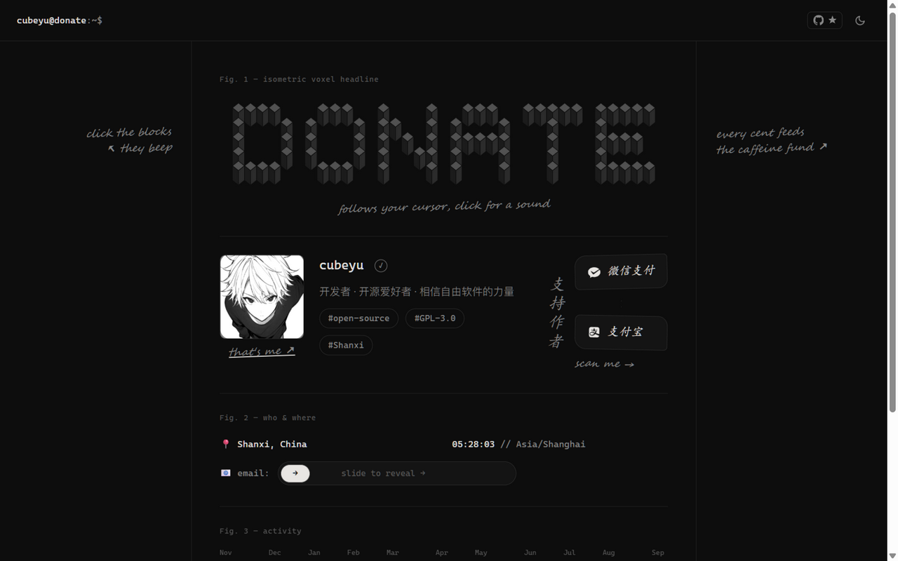
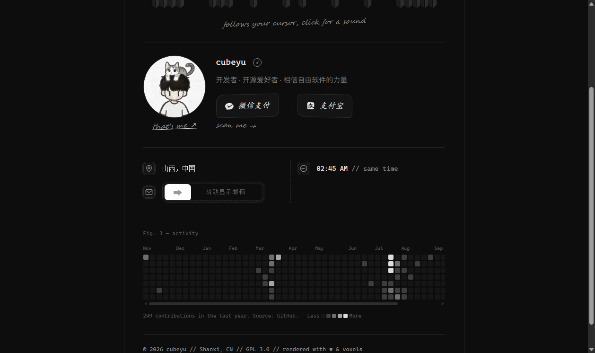
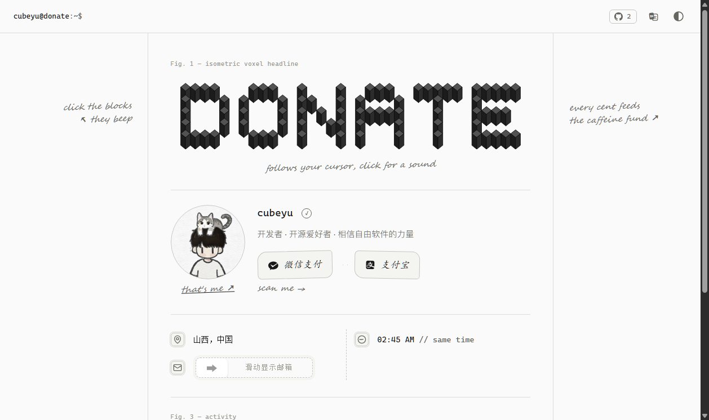
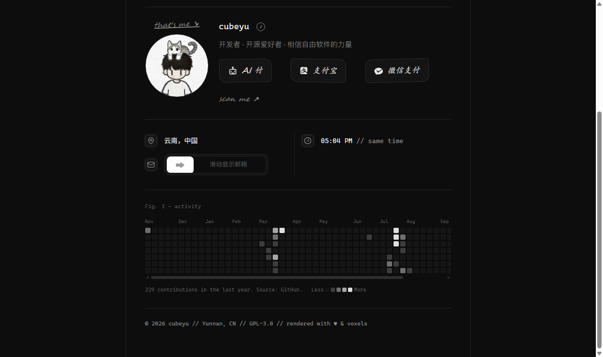
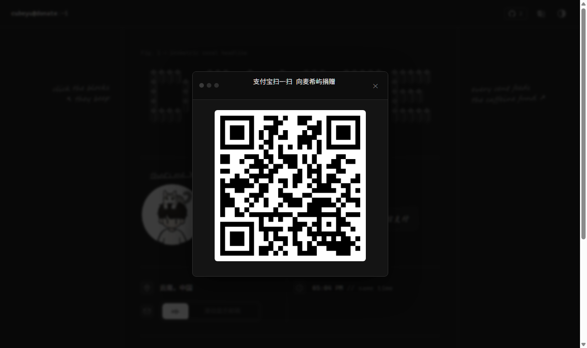

<div align="center">

# 支持作者 · DonatePage

**蓝图图纸风格的个人开源捐赠页**

[](LICENSE)
[](https://vercel.com)
[](#)
[](#)

🚀 **在线体验**：[donate.techisle.top](https://donate.techisle.top)

</div>

---



> 近黑底色上，等距像素积木拼出 "DONATE"，光标在终端提示符后闪烁——这是一张给收款页的"工程图纸"。

## 这是什么

一个**纯静态**的个人捐赠页：微信 / 支付宝收款码聚合、灰度 GitHub 贡献热力图、滑动解锁邮箱、昼夜双主题。没有后端、没有数据库、没有构建魔法——`pnpm build` 产出一个 `public/` 目录，推到 Vercel 就能上线。

## 关于原创性

本项目 fork 自 [Merger](https://github.com/qr-merger/merger) v0.28.6（GPL-3.0），但在我手中经历了两次彻底重写，如今从构建系统到视觉语言均为独立实现：

- **构建系统重写**——上游的 gulp 构建会覆盖源文件、引用不存在的目录；本项目重构了完整构建链（不碰源文件、产物隔离到 `public/`），并移除了全部 CDN 依赖（上游同时加载 cdnjs 与本地两份 bundle，我将其合并为零外链单文件加载）
- **安全加固**——收紧 CSP（`default-src 'none'` 白名单）、补齐安全响应头、SRI 风险随全本地化一并消除
- **视觉语言原创**——设计语言致敬 [anxforever.cn](https://anxforever.cn)（MIT）的图纸美学，但所有 CSS / JS 均为本项目原生实现：等距体素标题的 SVG 生成算法、灰度热力图渲染、滑动解锁交互、昼夜主题系统

如果这个页面对你有帮助，欢迎 [⭐ Star](https://github.com/cubeyu/DonatePage)。

## 请作者喝杯咖啡 ☕

> 坦白说，这一节也可以叫"赛博乞讨"。🙏
>
> 服务器要钱，域名要钱，支撑作者写代码的咖啡因也要钱。如果这个项目恰好帮到了你，可以**超绝不经意地**扫一下下面两张码——金额随意，一毛钱也是爱。（真的穷）

| 微信 | 支付宝 |
|:---:|:---:|
|  |  |

*也可以[点这里](https://donate.techisle.top)访问完整版捐赠页——那边有会发声的像素标题。*

## 特性

- 🧊 **蓝图美学**——三栏图纸网格、Fig. 学术标注、hatching 剖面线、手写批注
- 🧱 **等距体素标题**——JS 生成 SVG 立方体点阵，鼠标视差跟随，点击有 WebAudio 音效
- 📊 **GitHub 贡献热力图**——真实数据、灰度阶梯、悬浮 tooltip（[jogruber API](https://github-contributions-api.jogruber.de)，无 token）
- ⭐ **实时星标徽标**——导航栏 GitHub 图标 + 仓库 star 数
- 🌗 **昼夜双主题**——跟随系统偏好 + 手动切换 + localStorage 持久化 + 防闪烁
- 📧 **滑动解锁邮箱**——拖动滑块 reveal，防爬虫抓取
- 🕐 **实时时钟**——`Asia/Shanghai` 时区，秒级刷新
- 🔐 **安全加固**——严格 CSP、安全响应头、零第三方脚本
- 🌐 **三语适配**——简体中文 / 繁体中文 / English 自动切换
- 📱 **响应式**——窄屏自动收起图侧批注，热力图横向滚动

## 页面一览

| 资料区 | 昼间主题 |
|:---:|:---:|
|  |  |

| 贡献热力图 | 收款弹窗 |
|:---:|:---:|
|  |  |

## 快速开始

```bash
# 克隆
git clone https://github.com/cubeyu/DonatePage.git
cd DonatePage

# 安装依赖（pnpm ≥ 11）
pnpm install

# 构建产物到 public/
pnpm build

# 本地预览（默认 8080 端口）
pnpm start
```

部署：推送到 GitHub 后在 [Vercel](https://vercel.com) 导入仓库即可，`vercel.json` 已配置好构建命令与安全响应头。

## 自定义

**收款信息**——编辑 `index.html` 顶部配置区：

```js
var myname = "你的名字",
    profile = "assets/images/placeholder.webp",   // 头像：URL / 邮箱(Gravatar) / 本地路径
    wechat  = "wxp://...",                        // 微信收款码链接
    alipay  = "https://qr.alipay.com/...";        // 支付宝收款码链接
```

**个人信息**——在 `index.html` 中搜索替换：

- `cubeyu@aliyun.com` → 你的邮箱（滑动解锁组件）
- `Shanxi, China` / `#Shanxi` → 你的坐标
- `github.com/cubeyu` → 你的 GitHub
- `.profile-bio` 一行 → 你的简介
- 蓝图交互脚本中 `GH_USER = "cubeyu"` → 热力图的 GitHub 用户名

**主题配色**——`assets/styles/style.css` 顶部 `:root` 与 `[data-theme="light"]` 中的 CSS 变量。

**像素标题文字**——蓝图交互脚本的 `WORD` 与 `GLYPHS` 点阵（3×5 字模）。

改完记得 `pnpm build` 重新生成 bundle（`assets/bundles/` 是构建产物，不入库，由 CI/Vercel 在部署时生成）。

## 项目结构

```
├── index.html              # 页面 + 配置区 + 蓝图交互脚本
├── assets/
│   ├── js/function.js      # 核心逻辑：多语言 / UA 检测 / 二维码
│   ├── js/iconfont.js      # SVG 图标（微信 / 支付宝）
│   ├── styles/style.css    # 蓝图样式（自包含，零框架依赖）
│   └── bundles/            # 构建产物（pnpm build 生成，不入库）
├── gulpfile.js             # 构建链（绝不修改源文件）
├── vercel.json             # Vercel 配置 + 安全响应头
├── screenshots/            # README 截图
└── handoff.md              # 开发交接文档（审计记录 / 踩坑清单）
```

## 致谢

- **[Merger](https://github.com/qr-merger/merger)**（GPL-3.0）—— 本项目的起点，核心收款逻辑（多语言 / UA 检测 / 二维码）源自其 v0.28.6
- **[anxforever.cn](https://anxforever.cn)**（MIT）—— 图纸美学的灵感来源
- [jQuery](https://jquery.com) / [jquery-qrcode](https://larsjung.de/jquery-qrcode/) —— 打包进本地 bundle，无 CDN 依赖

## 参与贡献

- [贡献指南](.github/CONTRIBUTING.md) —— 本地开发、代码约定、提交规范
- [行为准则](.github/CODE_OF_CONDUCT.md) —— 社区交流的基本约定
- [安全政策](.github/SECURITY.md) —— 漏洞报告流程（请勿公开提交安全 Issue）
- [提交 Issue](https://github.com/cubeyu/DonatePage/issues/new/choose) —— Bug 报告 / 功能建议 / 配置求助

## 许可

[GPL-3.0](LICENSE) —— 继承自上游 Merger。 Fork 与二次开发请遵循同一协议。

---

<div align="center">

**如果这个项目帮到了你，[star 一下](https://github.com/cubeyu/DonatePage) 或 [支持作者](https://donate.techisle.top)** 🖤

`© 2026 cubeyu // Shanxi, CN // rendered with ♥ & voxels`

</div>
